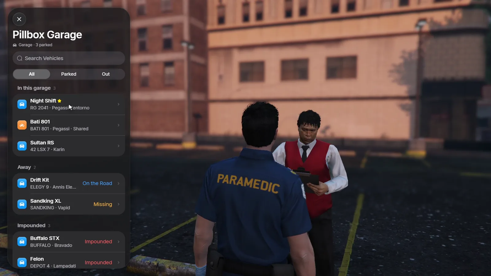
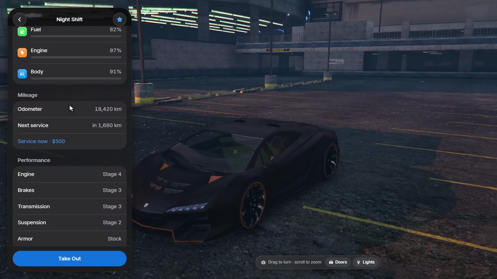
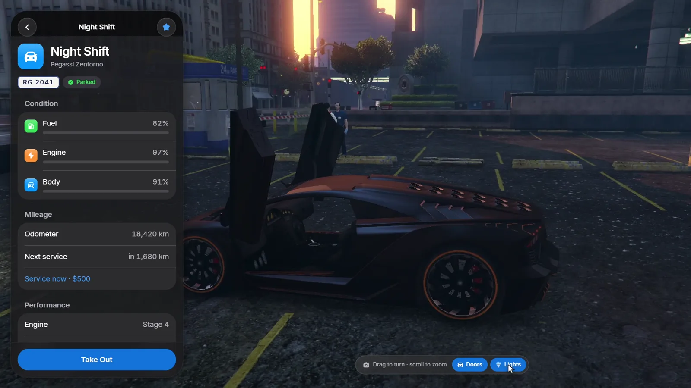
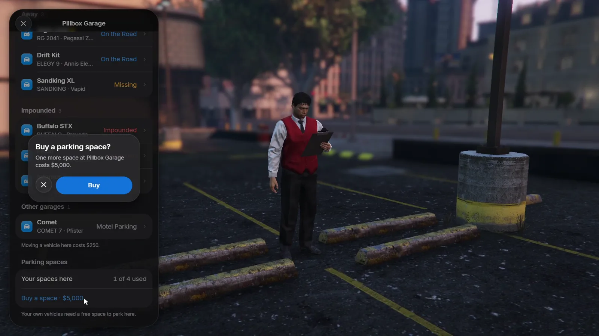

# Using garages

## Opening a garage

Walk up to the attendant at a garage and press **E**, or use the target
option when ox_target or qb-target runs. The key is a FiveM key binding:
players can change it under **Settings → Key Bindings → FiveM → Garage: open
or park**.

Garages come in three kinds: car garages hold cars and bikes, boat garages hold
boats, and hangars and helipads hold aircraft. A vehicle can only be parked in
a garage of its kind.

<Frame>
  
</Frame>

The list sorts your vehicles into sections:

| Section | What it shows |
|---|---|
| **In this garage** | Vehicles parked here, ready to take out |
| **Away** | Vehicles out in the world (**On the Road**) or lost (**Missing**) |
| **Impounded** | Vehicles waiting at an impound lot |
| **Other garages** | Vehicles parked elsewhere that you can move here |

Use the search field and the **All / Parked / Out** filters to find a vehicle
quickly. Vehicles you marked as favourites show a star; nicknames replace the
model name. See [Managing vehicles](/roadgarage/vehicles).

## The vehicle page and the live preview

Tap a vehicle to open its page. While it is open, the vehicle itself stands on
the garage's parking slot with an orbiting camera, so you can look at it before
you take it out.

<Frame>
  
</Frame>

The page shows:

- **Condition:** fuel, engine and body.
- **Mileage:** the odometer and when the next service is due, see
  [Mileage and service](/roadgarage/vehicles#mileage-and-service).
- **Performance:** the installed upgrades, such as engine, brakes,
  transmission, suspension and armour.
- **Manage:** rename, share keys, move, sell or give the vehicle, plus its
  activity log.

<Frame>
  
</Frame>

Preview controls sit at the bottom of the screen: drag to turn the camera,
scroll to zoom, and use **Doors** and **Lights** to open the doors and switch
on the lights.

## Taking a vehicle out

Press **Take Out**. The vehicle spawns on the first free parking slot of the
garage with its saved mods, fuel, engine and body health and, when
`Config.SaveDamage` is on, its broken doors, windows, burst tyres and dents.
You get the keys through your key script, and with `Config.WarpIntoVehicle`
you are placed in the driver's seat.

<Note>
  A slot counts as free when no other vehicle stands within
  `Config.SpawnClearance` metres. When every slot is blocked, you see "All
  parking spots are blocked." and the vehicle stays parked.
</Note>

## Parking

Drive into the garage area, near the attendant or a parking slot, and press
**E**. The vehicle is saved with its current mods, fuel, damage and mileage,
then removed from the world.

## Parking spaces

When parking spaces are limited (`Config.SlotLimit`, or `slots` on a garage),
the list shows how many of your spaces are used. You can buy extra spaces in
that garage, up to `Config.MaxExtraSlots`.

<Frame>
  
</Frame>

## Missing vehicles

A vehicle that is out but no longer exists in the world, for example after a
server restart, shows as **Missing**. You can recover it at
any garage for `Config.RecoveryFee`. With `Config.ReturnLostOnStart`, missing
vehicles return to their last garage on their own when the resource starts.

## Paying

Fees for moving, recovering, extra spaces and services are paid from the
accounts in `Config.PayFrom`, tried in order (bank first, then cash by
default). Where the money goes is set in
[Configuration](/roadgarage/configuration#fees-and-societies).
