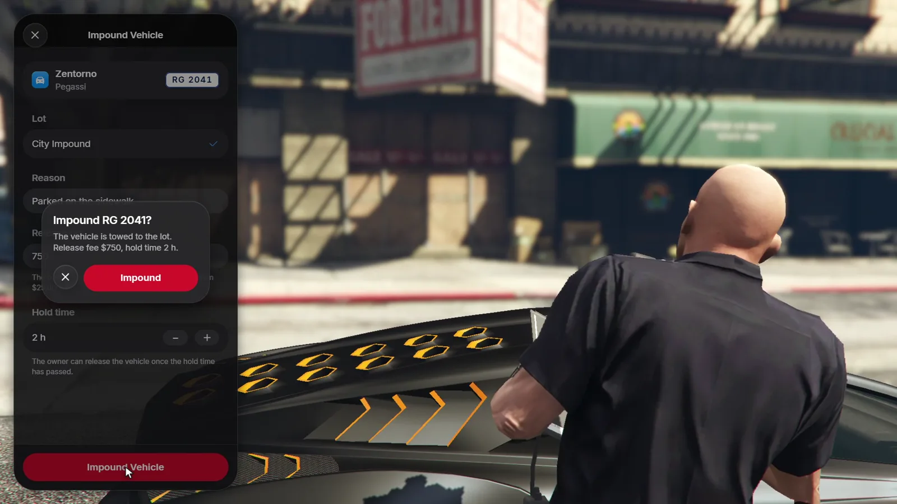
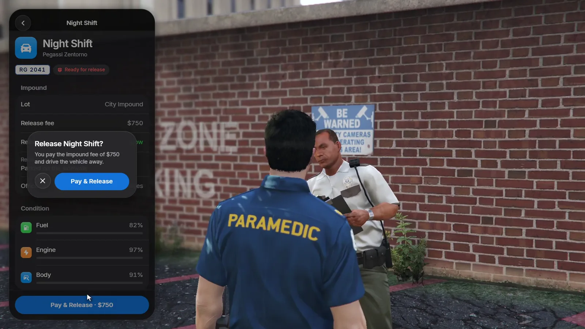

# Impound

Officers impound vehicles with a reason, a release fee and a hold time. The
vehicle is removed from the street and waits at an impound lot until its
owner pays the fee there.

## Impounding a vehicle

Officers are players with a job in `Config.Impound.Jobs` at or above its
minimum grade. Standing next to a vehicle, they use
[`/impound`](/roadgarage/commands#impound) or the **Impound Vehicle** target
option.

<Frame>
  
</Frame>

The form asks for:

| Field | Limits |
|---|---|
| **Lot** | An impound lot of the vehicle's kind |
| **Reason** | Up to 120 characters, shown to the owner |
| **Release fee** | Starts at `Config.Impound.DefaultFee`, up to `Config.Impound.MaxFee` |
| **Hold time** | From no hold up to `Config.Impound.MaxHours` hours |

After **Impound Vehicle** and the confirmation, the vehicle disappears from
the street and shows as **Impounded** in its owner's garages.

## Getting a vehicle back

The owner goes to the impound lot and talks to the attendant. The lot lists
every impounded vehicle of theirs with the reason, the officer and the fee.
Once the hold time has passed, the vehicle is **Ready for release**.

<Frame>
  
</Frame>

**Pay & Release** charges the fee, and the vehicle is waiting on the lot's
parking slot. Release fees go to the society in `Config.Impound.Society`
(`'police'` by default, `false` for nobody).

Officers can release a vehicle to its owner's garage for free, for example
after a wrongful impound.

The lot also lists the owner's **Missing** vehicles, which can be recovered
there for `Config.RecoveryFee`.

## Vehicles impounded by other scripts

Vehicles that another script impounded (for example qb-policejob, which sets
the vehicle's `state` to 2) also show up. Any lot of the vehicle's kind
releases them without a hold time, for the framework's depot price or, if there
is none, `Config.Impound.DefaultFee`.

## Impound lots

```lua config.lua
Config.ImpoundLots = {
    city = {
        label = 'City Impound', kind = 'car', blip = true,
        coords = vector4(400.45, -1630.87, 29.29, 228.88),
        spawns = { vector4(407.2, -1645.58, 29.31, 228.28) },
    },
    -- airport (air), marina (boat)
}
```

A lot uses the same fields as a garage, see
[Adding a garage](/roadgarage/configuration#adding-a-garage).

## From other scripts

Police and parking scripts can impound with the
[`ImpoundVehicle`](/roadgarage/api/exports#impoundvehicle) export, and admins
with [`/garageadmin`](/roadgarage/commands#garageadmin).
