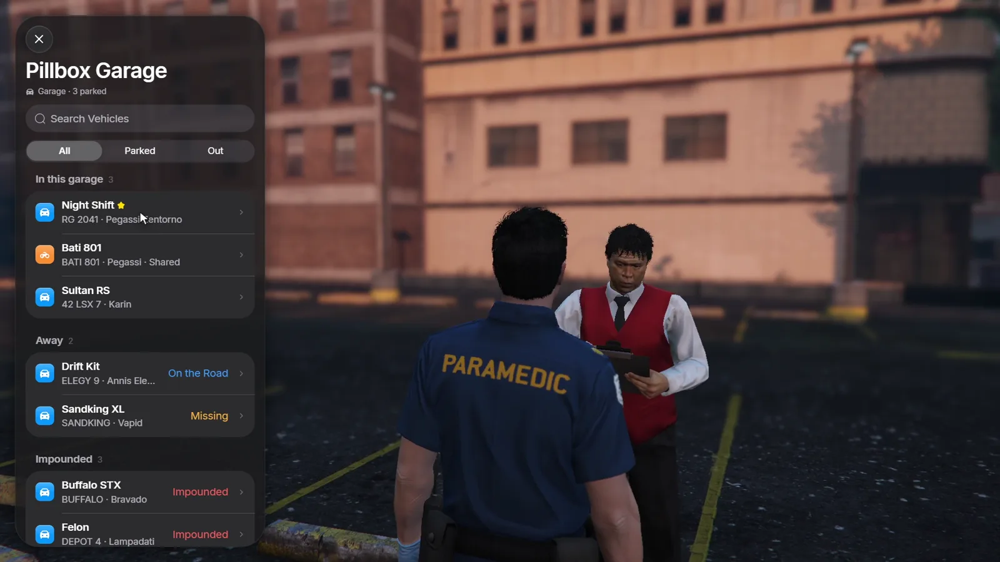

# Installation

RoadGarage covers garages, impound lots and vehicle sharing for your server.
It handles public car, boat and air garages, job and gang garages with fleets,
police impounds with a fee and a hold time, and selling a car to the player in
front of you. Players use it at garage attendants and impound lots on the map,
in the same design as RoadPhone.

Vehicle state is stored in your framework's own columns, so other scripts that
read `owned_vehicles` or `player_vehicles` keep working.

<Frame>
  
</Frame>

<Danger>
  **Do not use FileZilla**. It can corrupt or skip hidden files during upload.
  We recommend **WinSCP**.
</Danger>

<Note>
  The download comes from the [cfx.re Portal](/license-system). The database
  tables are created automatically on the first start.
</Note>

## 📋 Prerequisites

<CardGroup cols={2}>
  <Card title="OneSync" icon="radio-tower">
    Required: vehicles are spawned on the server (`set onesync on`).
  </Card>
  <Card title="oxmysql and ox_lib" icon="database">
    Both are required and must start before RoadGarage. mysql-async works
    instead of oxmysql.
  </Card>
  <Card title="Framework" icon="layers">
    ESX Legacy, QBCore, Qbox or no framework (standalone).
  </Card>
  <Card title="Optional" icon="puzzle">
    ox_target or qb-target, a vehicle key script and a fuel script. All of
    them are detected automatically.
  </Card>
</CardGroup>

## 🚀 Setup Instructions

<Steps>
  <Step title="Extract the resource">
    Put the folder into your resources. We recommend a `[road]` folder
    alongside our other scripts:

    ```bash
    resources/
    └── [road]/
        ├── road_garage/
        └── other_scripts/
    ```

    <Warning>
      The folder name must stay `road_garage`. Events and exports use this
      name.
    </Warning>
  </Step>

  <Step title="Start it after its dependencies">
    ```cfg server.cfg
    ensure oxmysql
    ensure ox_lib
    # your framework, key script, fuel script and housing script
    ensure road_garage
    ```

    Start RoadGarage after your housing script if you use
    [house garages](/roadgarage/job-garages#house-garages).
  </Step>

  <Step title="Stop your old garage script">
    Run only one garage system. Two garage scripts compete for the same
    vehicles and the same key. Stop the old one (for example qb-garages or
    qbx_garages) before you start RoadGarage.
  </Step>

  <Step title="Database">
    On the first start, RoadGarage creates its tables. On ESX it also adds
    `garage_id` and `impounded` to `owned_vehicles`.

    If your database user has no `ALTER` rights, run the files yourself:

    | File | When |
    |---|---|
    | `sql/install.sql` | New installation |
    | `sql/esx_columns.sql` | New installation on ESX |
    | `sql/migrations/1.1.0.sql` | Update from 1.0.0 |
  </Step>

  <Step title="Give your admins access (optional)">
    ```cfg server.cfg
    add_ace group.admin road_garage.admin allow
    ```

    This unlocks [`/garageadmin`](/roadgarage/commands#garageadmin).
  </Step>
</Steps>

## 🌐 Language

```lua config.lua
Config.Locale = 'en'
```

English (`en`) and German (`de`) are built in. The setting changes both the
in-game texts and the garage screen. To add your own language, see
[Configuration](/roadgarage/configuration#language).

## 📱 RoadPhone

RoadGarage keeps vehicle state in the framework's own columns (`stored` /
`state`, `garage_id` / `garage`). RoadPhone's Garage app and valet therefore
keep working without changes.

With `Config.roadGarage = true` in RoadPhone 3.0, the Garage app also shows:

- garage names and nicknames;
- mileage and impound details;
- vehicles shared with the player.

The valet then delivers through RoadGarage, with saved damage, fuel, keys and
the activity log.

## ✅ Verification

1. The server console shows no `road_garage` errors on start.
2. Garage and impound blips appear on the map.
3. At a garage attendant you get the target option or the **E** help text,
   and the garage opens with your vehicles.
4. A vehicle you take out spawns on a free parking slot. With a key script,
   you get its keys.

## 📚 Next Steps

<CardGroup cols={2}>
  <Card title="Using garages" icon="warehouse" href="/roadgarage/garages">
    Opening, parking, the vehicle page and the live preview
  </Card>
  <Card title="Impound" icon="siren" href="/roadgarage/impound">
    Impounding, hold times, fees and release
  </Card>
  <Card title="Configuration" icon="settings" href="/roadgarage/configuration">
    Garages, fees, parking spaces, mileage and hooks
  </Card>
  <Card title="FAQ" icon="badge-info" href="/roadgarage/faq">
    Any problems or questions?
  </Card>
</CardGroup>
