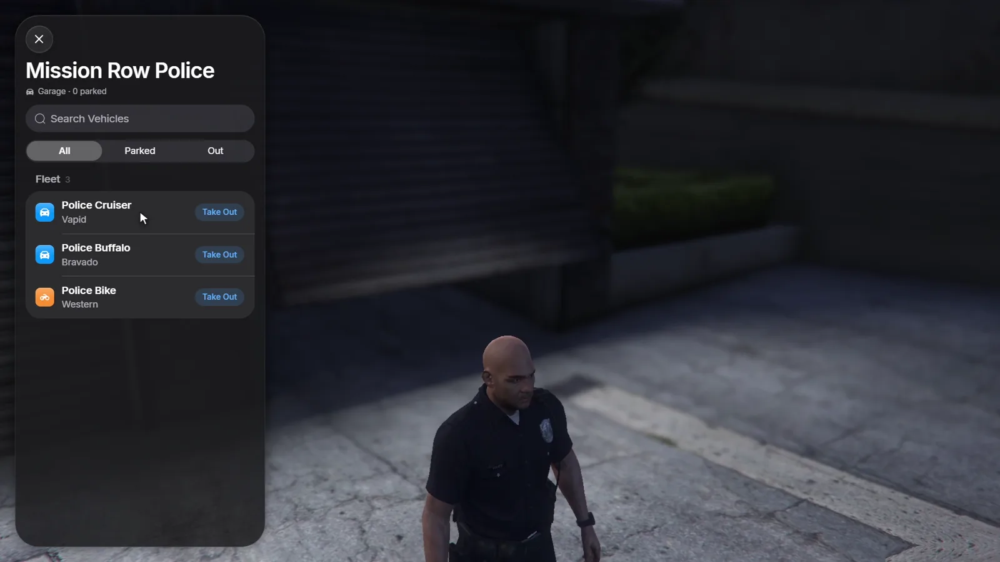

# Job, gang and house garages

## Job and gang garages

A garage with `job` or `gang` is open only to members at or above the given
grade. With `shared = true`, every member sees every vehicle parked there, not
just their own.

```lua config.lua
Config.Garages = {
    mrpd = {
        label = 'Mission Row Police', kind = 'car', blip = true,
        job = { police = 0 }, -- job = minimum grade
        shared = true, -- members see every vehicle parked here
        ped = { model = 's_m_y_cop_01' },
        coords = vector4(454.6, -1017.4, 28.4, 0.0),
        spawns = { vector4(438.4, -1018.3, 27.7, 90.0) },
    },
    ballas = {
        label = 'Ballas Garage', kind = 'car', blip = true,
        gang = { ballas = 0 }, shared = true,
        coords = vector4(87.51, -1969.1, 20.75, 319.6),
        spawns = { vector4(93.78, -1961.73, 20.34, 319.11) },
    },
}
```

`job` and `gang` can list several names, for example
`job = { police = 0, sheriff = 2 }`. Gangs need a framework with gangs
(QBCore or Qbox).

## Job fleets

A `fleet` gives a job garage vehicles that nobody owns. Members take them out
with **Take Out** next to each model, and only see the models their grade
allows.

<Frame>
  
</Frame>

```lua config.lua
fleet = {
    { model = 'police', label = 'Police Cruiser', grade = 0, plate = 'LSPD' },
    { model = 'police2', label = 'Police Buffalo', grade = 1, plate = 'LSPD' },
    { model = 'police3', label = 'Police Interceptor', grade = 2, plate = 'LSPD' },
},
```

| Field | Meaning |
|---|---|
| `model` | Spawn name of the vehicle |
| `label` | Name in the list |
| `grade` | Lowest job grade that may take it out |
| `plate` | Start of the plate; the rest is filled with numbers |

`Config.FleetLimit` caps the fleet vehicles one player has out at the same
time (1 by default, 0 = no limit). At the limit, the oldest one nobody is
sitting in is returned when the player takes out a new one.

## House garages

With `Config.Housing`, players get a garage at each house they own or have
keys to. It is read from qb-houses, qs-housing or ps-housing when the player's
garage list loads.

```lua config.lua
Config.Housing = 'auto' -- 'qb-houses', 'qs-housing', 'ps-housing'; 'auto' detects them, false = off
```

Start RoadGarage after your housing script. A player who loses a house loses
its garage the next time the list loads. Other housing scripts can add garages
themselves with the [`RegisterGarage`](/roadgarage/api/exports#registergarage)
export.
