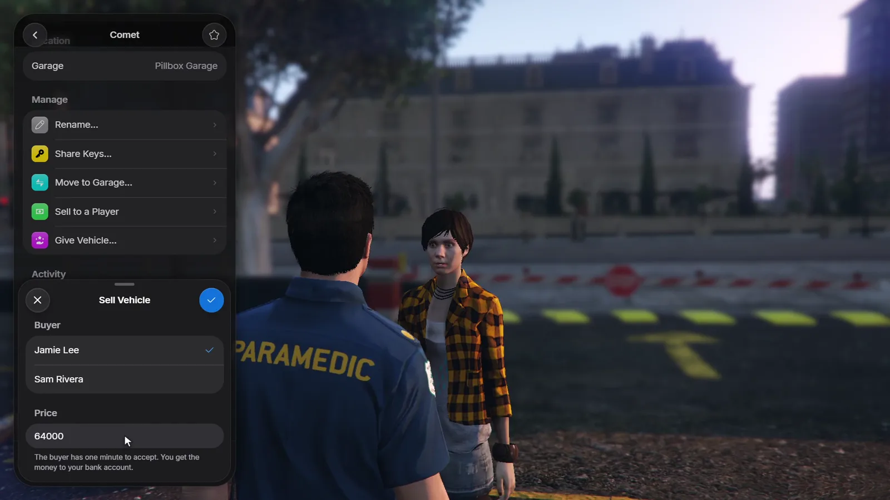
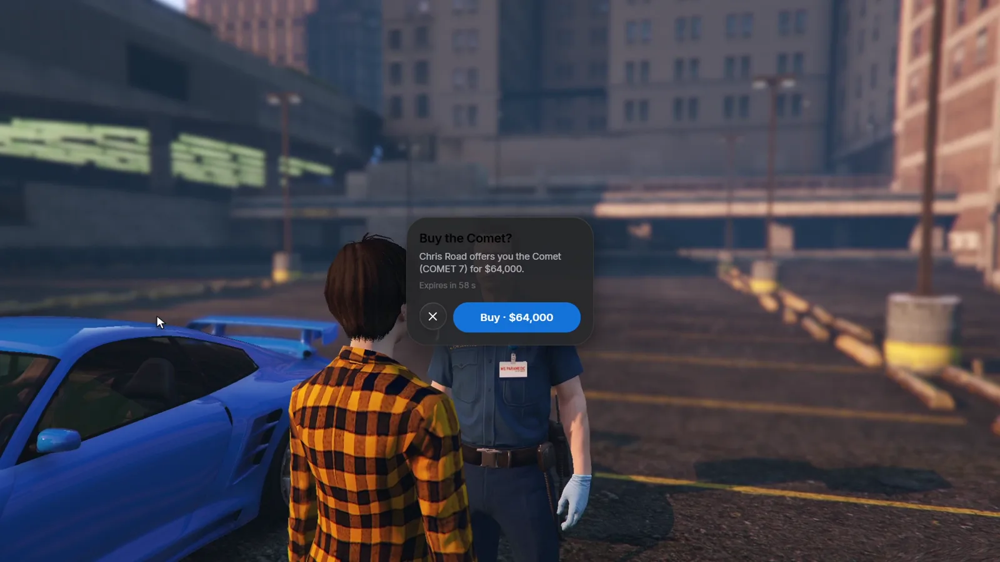

# Managing vehicles

The **Manage** section of a vehicle's page holds everything an owner can do
with it. Players who only hold keys can take a shared vehicle out and park it,
but they cannot manage it.

## Nicknames and favourites

- **Rename:** give the vehicle a nickname. It replaces the model name in the
  list.
- **Favourite:** tap the star in the page header. Favourites show a star in
  the list.

## Sharing keys

**Share Keys** gives a player near you (8 metres) access to the vehicle: they see it in
their garages and can take it out and park it. One vehicle can be shared with
up to `Config.ShareLimit` players. Remove a player from the same list to take
the access back.

## Moving a vehicle

Vehicles parked in another garage of the same kind appear under **Other
garages** (with `Config.ShowOtherGarages`). **Move to Garage** brings the
vehicle here for `Config.TransferFee`.

## Giving and selling

Both work for a parked vehicle and a player standing next to you (5 metres).

<Tabs>
  <Tab title="Give Vehicle">
    Transfers the vehicle for free. Its shared keys, nickname and favourite
    are cleared, and the new owner gets a notification.
  </Tab>
  <Tab title="Sell to a Player">
    Pick the buyer, enter a price (up to `Config.SellMaxPrice`) and send the
    offer. The buyer sees it on their screen and has one minute to accept or
    decline. When they accept, the price is taken from their accounts in
    `Config.PayFrom` and paid into your bank account, and the vehicle changes
    owner on the server. Its shared keys, nickname and favourite are cleared.

    After the buyer declines, you can make them a new offer after 30 seconds.
  </Tab>
</Tabs>

<CardGroup cols={2}>
  <Frame>
    
  </Frame>
  <Frame>
    
  </Frame>
</CardGroup>

## Activity log

Every vehicle keeps a log of what happened to it: taken out and parked, moved,
shared, impounded and released, serviced, given or sold, with who did it and
where. Entries older than `Config.HistoryDays` are removed.

## Mileage and service

Every RoadGarage vehicle has an odometer. It counts while the vehicle is
driven, in kilometres or miles (`Config.Mileage.Unit`). The vehicle page
shows the reading and when the next service is due
(`Config.Mileage.ServiceInterval`).

A vehicle is serviced in one of two ways:

- **By a mechanic:** players with a job in `Config.Service.Jobs` use
  [`/service`](/roadgarage/commands#service) or the target option next to the
  vehicle.
- **At a garage:** when `Config.Service.GarageFee` is above 0, owners service
  the vehicle from its page for that fee.

Set `ServiceInterval = 0` to turn the reminders off.

## Damage

With `Config.SaveDamage`, broken doors, windows, burst tyres and dents are
saved when a vehicle is parked and are back when it is taken out. Engine and
body health and fuel are always saved.
