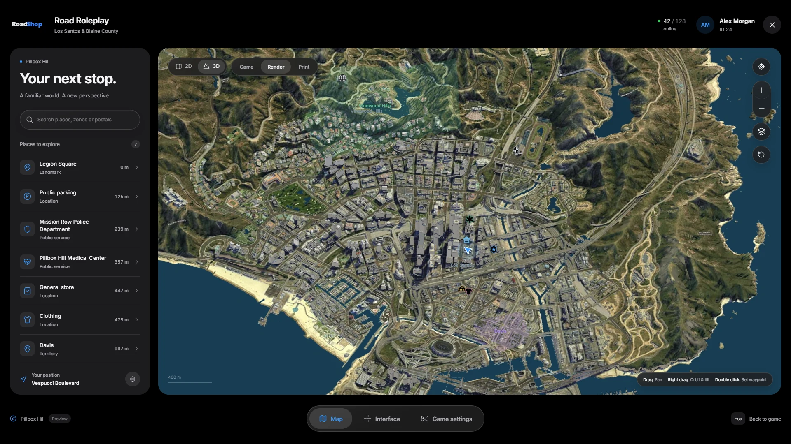

# Installation

Road Pause Menu replaces the pause menu and the minimap with one interface:
a 2D and 3D world map with search and GPS routes, a minimap players can shape
themselves, your server's name and logo, and a hand-off to the native game
settings.

<Frame>
  
</Frame>

<Danger>
  **Do not use FileZilla**. It can corrupt or skip hidden files during upload.
  We recommend **WinSCP**.
</Danger>

<Note>
  The download comes from the [cfx.re Portal](/license-system). No database
  and no SQL import are needed: player preferences are saved on each player's
  own PC.
</Note>

## 📋 Prerequisites

<CardGroup cols={2}>
  <Card title="Framework" icon="layers">
    ESX, QBCore, Qbox or no framework (standalone). The included RoadShop
    Bridge detects it automatically.
  </Card>
  <Card title="Outbound HTTPS" icon="globe">
    3D buildings and map images stream from RoadShop's map service. See
    [Map data](/roadpausemenu/map-data).
  </Card>
</CardGroup>

## 🚀 Setup Instructions

<Steps>
  <Step title="Extract the resource">
    Put the folder into your resources. We recommend a `[road]` folder
    alongside our other scripts:

    ```bash
    resources/
    └── [road]/
        ├── road_pausemenu/
        └── other_scripts/
    ```

    <Warning>
      The folder name must stay `road_pausemenu`. Exports, the blip
      integration and the map data address use this name.
    </Warning>
  </Step>

  <Step title="Start it after your framework">
    ```cfg server.cfg
    # your framework first
    ensure road_pausemenu
    ```
  </Step>

  <Step title="Add your server name and logo">
    ```lua config.lua
    Config.Server = {
        Name = 'Road Roleplay',
        Subtitle = 'Los Santos & Blaine County',
        Logo = 'assets/server-logo.svg'
    }
    ```

    Replace `public/assets/server-logo.svg` with your own logo, or put an
    `.svg`, `.png`, `.webp` or `.jpg` file into `public/assets/` and point
    `Logo` at it. Web addresses are not allowed here.
  </Step>

  <Step title="Restart the server">
    Restart the server, or run `refresh` and `ensure road_pausemenu` in the
    server console.
  </Step>
</Steps>

## 🌐 Language

```lua config.lua
Config.Locale = 'en'
```

English (`en`) and German (`de`) are built in. `Config.Locale` is the
language for new players; each player can switch it in **Interface**. The
texts live in `public/locales/en.json` and `public/locales/de.json` and stay
editable after the Asset Escrow upload.

## ✅ Verification

1. The server console shows no `road_pausemenu` errors on start.
2. In game, **Esc** opens the menu with your server name and logo instead of
   the GTA pause menu.
3. **F10** or `/roadmap` opens the map.
4. The map loads the city in **3D** after a short moment, and the minimap
   appears in the bottom left corner.

## 📚 Next Steps

<CardGroup cols={2}>
  <Card title="Player guide" icon="map" href="/roadpausemenu/player-guide">
    Map, search, routes, minimap and interface settings
  </Card>
  <Card title="Configuration" icon="settings" href="/roadpausemenu/configuration">
    Keys, places, territories and branding
  </Card>
  <Card title="Map data" icon="cloud-download" href="/roadpausemenu/map-data">
    How the 3D map streams and what your server stores
  </Card>
  <Card title="FAQ" icon="badge-info" href="/roadpausemenu/faq">
    Any problems or questions?
  </Card>
</CardGroup>
