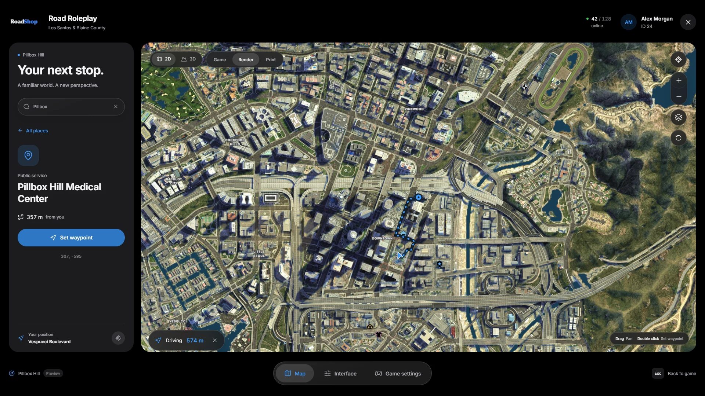
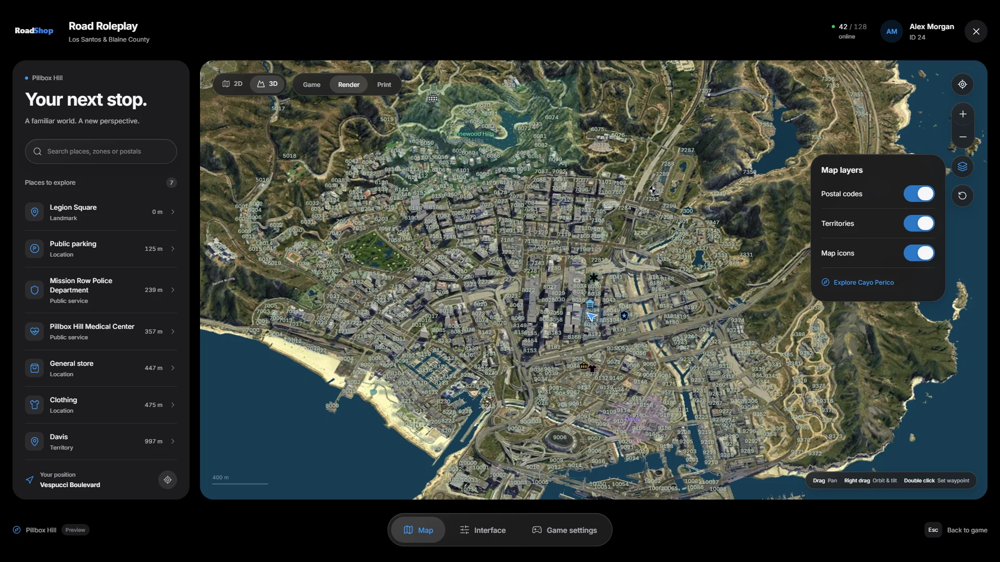
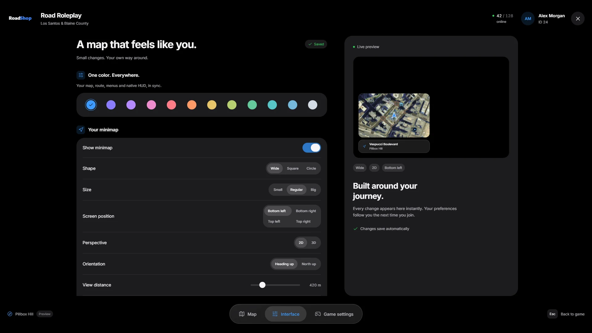

# Player Guide

This page shows what your players see. You can link it in your Discord.

## Opening the menu

| Input | Opens |
|---|---|
| **Esc** or **P** | The pause menu (unless `Config.PauseMenu = false`) |
| **F10** or `/roadmap` | The map. Press again to close |
| **Esc** while the menu is open | Back to the game |

Players can change **F10** in the GTA settings under **Key Bindings → FiveM**.

The menu has three tabs: **Map**, **Interface** and **Game settings**. The
header shows the server name and logo, the player's name, ID and headshot and
how many players are online.

## Map

<Frame>
  
</Frame>

### Views and styles

- **2D** shows the map from above. **3D** shows the terrain and the city's
  buildings; hold the right mouse button to orbit and tilt.
- **Render**, **Game** and **Print** are three map styles. Render is the
  default.
- In 3D, buildings appear in built-up areas only. Mountains and countryside
  stay terrain with the satellite image.

### Moving around

| Control | Action |
|---|---|
| Drag | Pan |
| Right drag (3D) | Orbit and tilt |
| Mouse wheel, **+** / **−** buttons or keys | Zoom |
| Arrow keys | Pan |
| **R** or the target button | Center on your position |
| Circular arrow button | Show the whole map |
| Double click | Set a waypoint |

### Search

The sidebar lists the server's places with their distance. The search finds
places, territories, map icons and postal codes; type a number to search
postals. Select a result to see its details and press **Set waypoint**.

### Waypoints and routes

A waypoint draws an animated route with its distance at the bottom of the
map. On foot and in cars the route follows the roads. Boats and aircraft get
a direct line. The **×** next to the distance clears the waypoint.

### Map layers

<Frame>
  
</Frame>

The layers button switches **Postal codes**, **Territories** and **Map icons**
on and off. **Explore Cayo Perico** moves the map to the island (unless the
server turned the island off).

## Interface

<Frame>
  
</Frame>

Every change shows in the live preview at once and is saved automatically on
the player's PC for the next session.

| Setting | Options |
|---|---|
| Color | 12 theme colors for the map, route, menus and the native HUD |
| Show minimap | On or off |
| Shape | Wide, square or circle |
| Size | Small, regular or big |
| Screen position | Bottom left, bottom right, top left or top right |
| Perspective | 2D or 3D minimap |
| Orientation | Heading up or north up |
| View distance | 150 to 1,500 m |
| Opacity | 35 to 100 % |
| Adaptive zoom | Shows further ahead as you drive faster |
| Map display | Postal codes, territories and map icons on the minimap and map |
| Reduce motion | Fewer animations |
| Language | English or Deutsch |

`/roadmapreset` restores all interface settings to their defaults.

## Game settings

**Open game settings** opens the GTA settings for graphics, sound and
controls. Closing them returns the player to the session.
